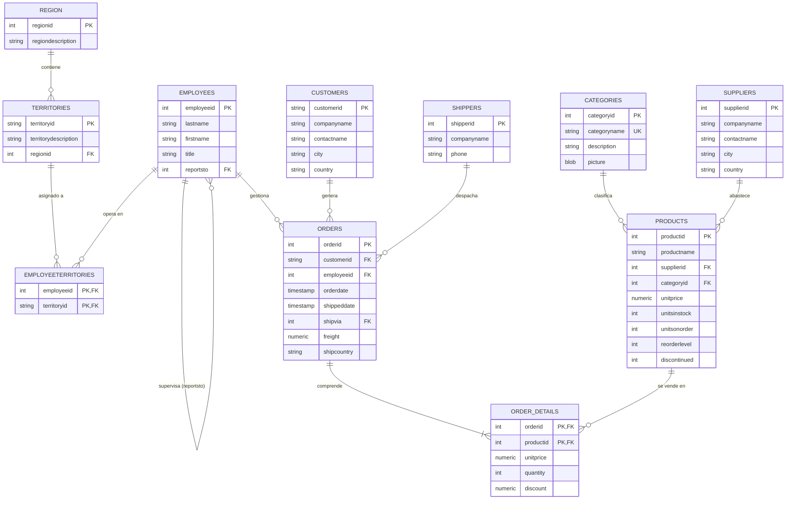
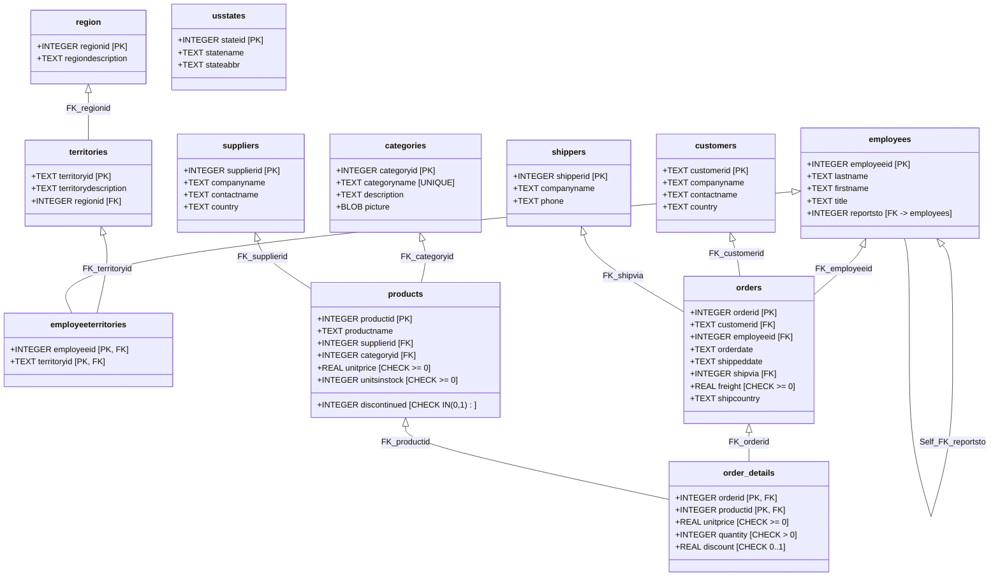

# Northwind Analytics Hub & BI Data Engineering Suite

Proyecto académico y profesional de arquitectura de datos, analítica e inteligencia de negocios construido a partir de los datos históricos de `Data/northwind.xlsx`.

---

## 1. Resumen Ejecutivo y Resultados de Auditoría

- **Fuente de Datos**: [northwind.xlsx](file:///c:/Users/USUARIO/.gemini/NorthWind-db-Dashboard/Data/northwind.xlsx) (13 hojas analizadas).
- **Integridad Referencial (FK Check)**: **0 violaciones detectadas** (100% íntegro).
- **Ventas Netas Verificadas**: **\$1,265,793.04** calculadas rigurosamente según la fórmula:
  $$\text{Ventas Netas} = \sum (\text{unitprice} \times \text{quantity} \times (1 - \text{discount}))$$
- **Unidades Vendidas Reconciliadas**: **51,317 unidades** (coincidencia idéntica contra Excel).
- **Costo de Flete Reconciliado**: **\$64,942.69** (coincidencia idéntica contra Excel).
- **Motor de Base de Datos**: SQLite 3 embebido de alto rendimiento + Scripts compatibles con PostgreSQL ANSI.

---

## 2. Inspección del Archivo Excel y Justificación de Entidades

El archivo `northwind.xlsx` contiene 13 hojas. A continuación se presenta el mapeo de modelado dimensional y la justificación de cada tabla:

| Hoja Excel | Filas | Clave Primaria (PK) | Función en el Modelo | Estado / Justificación |
| :--- | :---: | :--- | :--- | :--- |
| `categories` | 8 | `categoryid` (INT) | Dimensión de familias de producto | Incluida en el esquema |
| `customers` | 91 | `customerid` (TEXT) | Dimensión de clientes y compradores | Incluida en el esquema |
| `employees` | 9 | `employeeid` (INT) | Dimensión jerárquica de representantes | Incluida (con autorreferencia `reportsto`) |
| `employeeterritories` | 49 | `(employeeid, territoryid)` | Tabla de enlace M:N entre empleados y zonas | Incluida en el esquema |
| `order_details` | 2155 | `(orderid, productid)` | Hechos transaccionales a nivel ítem | Incluida con restricciones `quantity > 0` |
| `orders` | 830 | `orderid` (INT) | Hechos a nivel cabecera / despacho | Incluida con FK a cliente, empleado y shipper |
| `products` | 77 | `productid` (INT) | Catálogo e inventarios | Incluida con validación de stock y precios |
| `region` | 4 | `regionid` (INT) | Jerarquía geográfica superior | Incluida en el esquema |
| `shippers` | 6 | `shipperid` (INT) | Dimensión de empresas transportistas | Incluida en el esquema |
| `shippers_tmp` | 6 | `ShipperID` (INT) | Copia temporal idéntica a `shippers` | **Omitida justificadamente**: Duplicado exacto de `shippers` |
| `suppliers` | 29 | `supplierid` (INT) | Proveedores de manufactura | Incluida en el esquema |
| `territories` | 53 | `territoryid` (TEXT) | Territorios comerciales vinculados a región | Incluida en el esquema |
| `usstates` | 51 | `stateid` (INT) | Dimensión auxiliar de estados federales | Incluida para homologación postal |

---

## 3. Diagrama Entidad-Relación (Mermaid con Cardinalidades)



---

## 4. Diagrama del Esquema Físico de Base de Datos



---

## 5. Segmentación RFM de Clientes y Supuestos del Modelo

### Supuestos Teóricos:
1. **Fecha de Corte (Snapshot)**: Se fijó en **`1998-05-06`**, correspondiente a la fecha de la última transacción histórica registrada en `orders`.
2. **Métricas Computadas**:
   - **Recency ($R$)**: Días transcurridos entre la fecha de corte y la última compra del cliente: $\text{Recency} = \text{Date}_{\text{max}} - \text{Date}_{\text{last\_order}}$.
   - **Frequency ($F$)**: Cantidad de órdenes únicas generadas por el cliente: $\text{COUNT(DISTINCT orderid)}$.
   - **Monetary ($M$)**: Facturación neta total generada en USD aplicando la fórmula obligatoria de descuento.
3. **Scoring de Cuartiles (1 a 4)**:
   - $R$: $Q1 \le 8\text{ días (Score 4)}$, $Q2 \le 23\text{ días (Score 3)}$, $Q3 \le 58\text{ días (Score 2)}$, $>58\text{ días (Score 1)}$.
   - $F$: $\ge 12\text{ (Score 4)}$, $\ge 8\text{ (Score 3)}$, $\ge 5\text{ (Score 2)}$, $< 5\text{ (Score 1)}$.
   - $M$: $\ge \$16,817.10\text{ (Score 4)}$, $\ge \$7,048.24\text{ (Score 3)}$, $\ge \$3,239.80\text{ (Score 2)}$, $< \$3,239.80\text{ (Score 1)}$.

### Hallazgo Analítico:
- Del universo total de 91 clientes, **89 clientes son activos** con transacciones registradas.
- **2 clientes** (`FISSA` y `PARIS`) están registrados en el maestro pero registran 0 órdenes (clasificados como *Inactivos / Sin Compras*).

---

## 6. Instrucciones para Ejecutar el Proyecto Localmente

### Requisitos Previos:
- Node.js (v18 o superior)
- PowerShell o Terminal Bash

### Pasos de Puesta en Marcha:

1. **Navegar a la carpeta del proyecto**:
   ```powershell
   cd c:\Users\USUARIO\.gemini\NorthWind-db-Dashboard
   ```

2. **Instalar dependencias**:
   ```powershell
   & "C:\Program Files\nodejs\npm.cmd" install
   ```

3. **Ejecutar el Pipeline ETL de carga a SQLite**:
   ```powershell
   & "C:\Program Files\nodejs\node.exe" scripts/load_data.js
   ```

4. **Correr las pruebas de integridad y reconciliación**:
   ```powershell
   & "C:\Program Files\nodejs\node.exe" scripts/verify_integrity.js
   ```

5. **Iniciar el servidor web y dashboard interactivo**:
   ```powershell
   & "C:\Program Files\nodejs\node.exe" server/index.js
   ```

6. **Abrir en el navegador**:
   Visita en cualquier explorador la URL: **[http://localhost:4000](http://localhost:4000)**

---

## 7. Estructura de Directorios del Repositorio

```
NorthWind-db-Dashboard/
├── Data/
│   └── northwind.xlsx              # Archivo maestro original
├── database/
│   ├── schema_sqlite.sql           # DDL con restricciones e índices SQLite
│   ├── schema_postgresql.sql       # DDL compatible con PostgreSQL
│   ├── analytical_queries.sql      # Suite de consultas SQL comentadas
│   └── northwind.db                # Base de datos relacional compilada
├── scripts/
│   ├── inspect_excel.js            # Inspección automatizada de metadatos
│   ├── load_data.js                # Pipeline ETL de transformación y carga
│   ├── test_rfm.js                 # Algoritmo de calibración de cuartiles RFM
│   └── verify_integrity.js         # Suite de pruebas unitarias y reconciliación
├── server/
│   ├── index.js                    # Servidor API REST Express
│   └── rfm.js                      # Motor matemático de segmentación RFM
├── public/
│   ├── index.html                  # Dashboard SPA profesional
│   └── app.js                      # Lógica reactiva de gráficos y filtros
├── package.json                    # Manifiesto de dependencias npm
└── README.md                       # Documentación técnica completa
```
